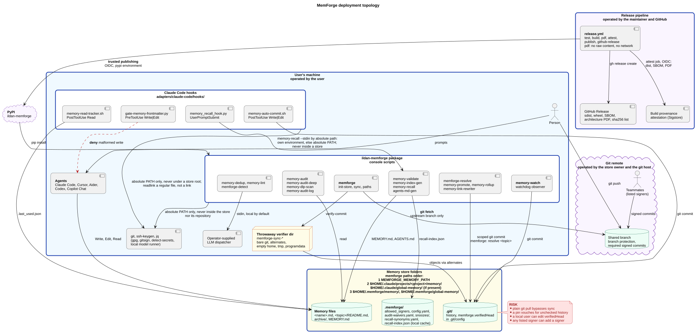
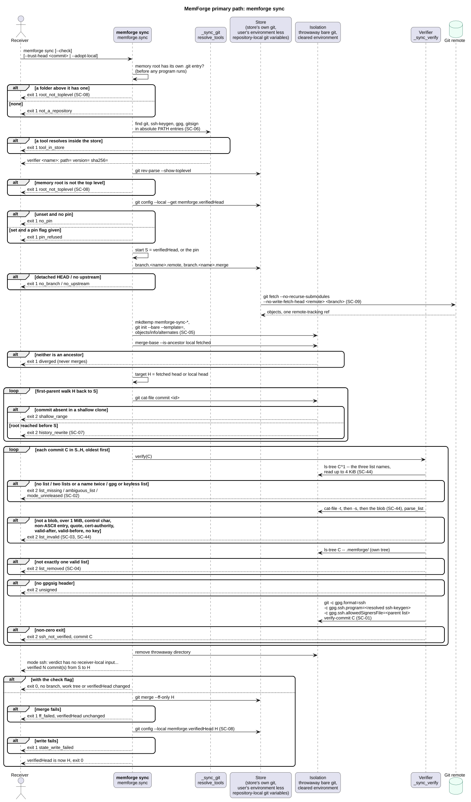
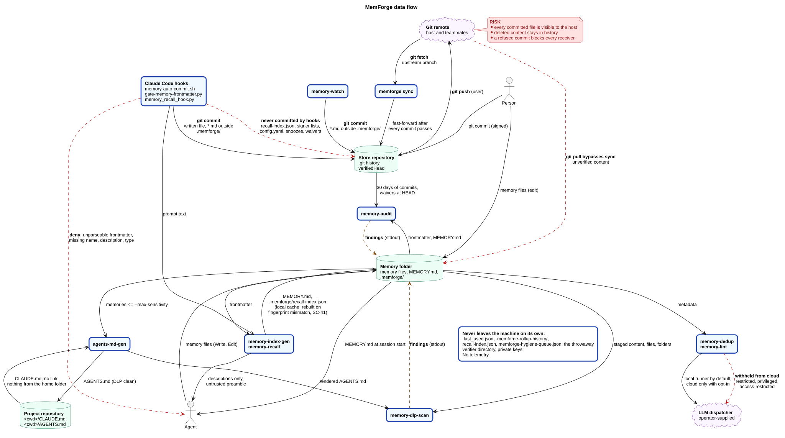
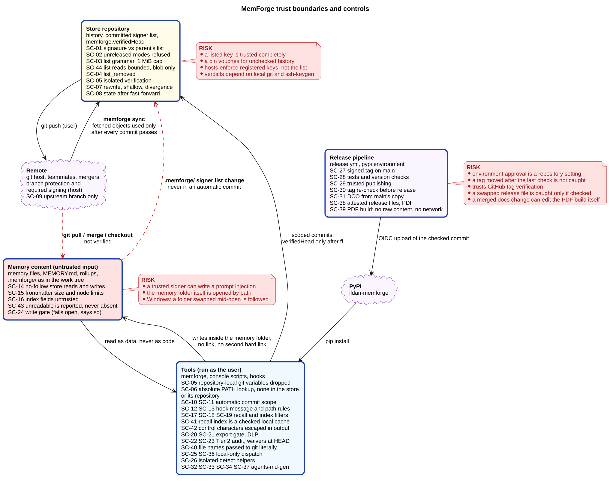
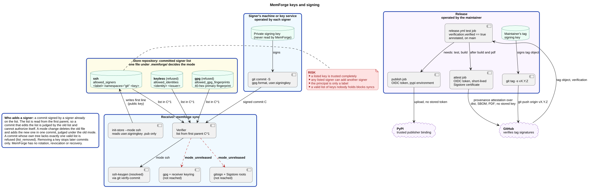
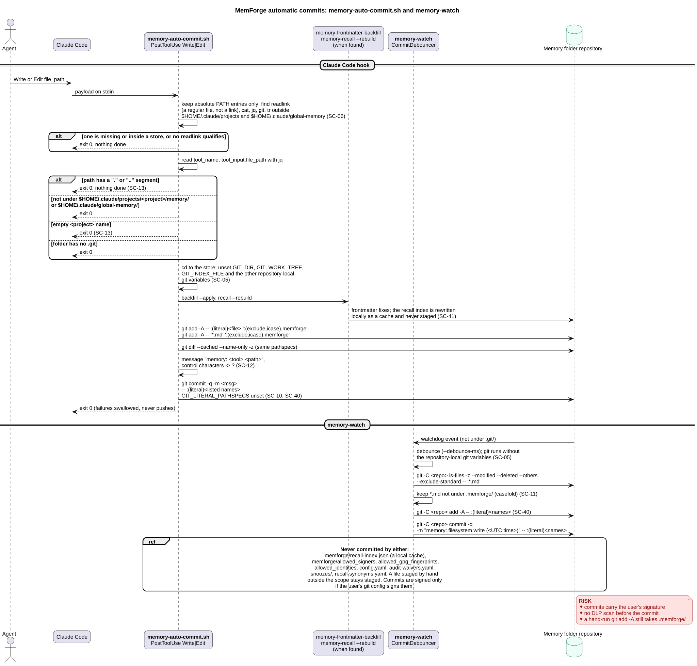
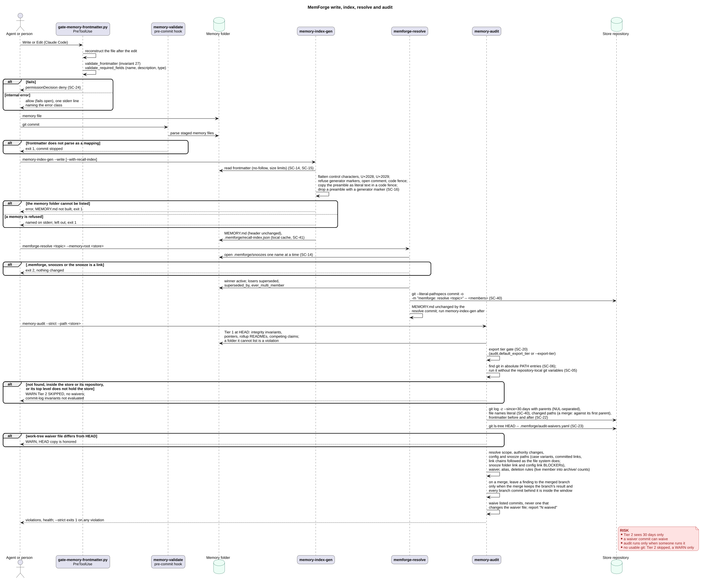
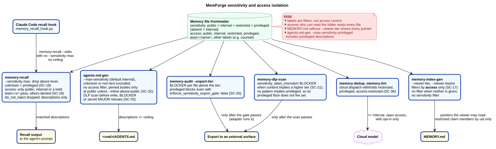

# MemForge Architecture Diagrams

Version: 1.0.0. Read with the [architecture overview](overview.md) and the [threat model](threat-model.md).

## What MemForge is

MemForge is a file format and a set of command-line tools for the persistent memory of coding agents. A memory is a markdown file with YAML frontmatter in a memory folder. Agents and people write those files. The tools validate them, generate the `MEMORY.md` index, the recall index and an `AGENTS.md` surface from them, scan them for secrets, audit them, and commit them to git.

MemForge has no server and holds no keys. Everything runs as the user on the user's machine, against folders the user owns. A folder that several people share is a git repository. `memforge sync` takes in new history from its remote only when every first-parent commit is signed by a signer the store's committed list names. The package's own code opens no network connection. The only programs it starts that can reach a network are the `git fetch` that `memforge sync` runs against the user's configured remote, and an LLM dispatcher command the operator supplies to `memory-dedup`, `memory-lint` or `memforge-detect`.

The system has five planes:

- **Memory content**: the memory files, `MEMORY.md` and the `.memforge/` control files as they stand in the work tree. Anyone or anything that can write the folder can change them, so every tool treats them as untrusted input.
- **Tools**: the `memforge` command, the per-tool console scripts and the Claude Code hooks. They run with the user's own permissions.
- **Store repository**: the git history of a shared store, the signer list committed under `.memforge/`, and the local state key `memforge.verifiedHead`.
- **Remote**: the git remote a store syncs from, its host, and the teammates who can push there.
- **Release pipeline**: the project's GitHub repository, its release workflow, and the PyPI project `ildan-memforge` that users install from.

Control IDs in the diagrams (`SC-01` to `SC-44`) refer to the control table in section 6 of the [architecture overview](overview.md#6-security-controls-summary). Notes with a red border mark the main risks that remain at a component.

## Diagrams

The diagrams are vector graphics. Open one at full size, or zoom in, for detail.

### 1. Deployment topology

What runs where and who operates it. The user's machine runs the agents, the Claude Code hooks and the `ildan-memforge` console scripts. Those tools work on the memory store folders, in the order `memforge paths` prints them. A shared store syncs with a git remote that teammates push to. The release pipeline publishes the package to PyPI through trusted publishing, and attaches the package, its SBOM and the architecture PDF to the GitHub Release under one build provenance attestation. The PDF is built from the docs with raw content of any format, outside images, attributes and metadata refused, and printed with no network. Every helper program is found on absolute `PATH` entries only, never inside the store; the tools also refuse one elsewhere in the store's git repository, and `memory-audit` skips Tier 2 with a WARN when its `git` is refused. The recall hook starts `memory-recall` from its own Python environment or an absolute `PATH` entry, never from inside a store. `memforge sync` verifies commits in a throwaway, isolated verifier directory.

### 2. Primary path: memforge sync

How a receiver takes in shared history. Sync first checks that the memory folder is the top of its own repository, before it runs any program. It then finds its tools outside the store, runs its store git commands without the repository-local git variables, reads the verified head or a one-time pin, and fetches only the upstream branch. It walks the first-parent history and verifies each commit in the isolated verifier against the signer list of that commit's parent, reading a list only when its entry is a blob within the size cap. Only when every commit passes does it fast-forward and record the new verified head. Each refusal has a named reason and exit code.

### 3. Data flow

Every path data takes. Memory files come from people and agents. The index, recall and `AGENTS.md` are generated from them (the recall index is a local cache that no tool commits, and `memory-recall` rebuilds it when a fingerprint of the memory files no longer matches); `AGENTS.md` also takes the project repository's own `CLAUDE.md`, and nothing from the home folder. The DLP scan and the audit check them. Sync brings history in, and push sends it out. The only data that leaves the machine goes to the user's git remote and, when the operator opts in, to an operator-supplied LLM dispatcher. Red dashed arrows show the paths that are stopped or not verified: writes the frontmatter gate denies, control files and the recall index that the hooks never commit, memories withheld from a cloud model, and a plain `git pull` that bypasses sync.

### 4. Trust boundaries and controls

The five planes, the controls enforced at each one, and what crosses between them. Content in the memory folder is untrusted input and is read as data, never as code. Only `memforge sync` brings remote history in as verified. A plain `git pull`, merge or checkout is not verified. Automatic commits never carry a signer-list change, and tools that commit by file name pass the names to git literally. The tools print store text with control characters shown as visible escapes, and report a folder they cannot look at instead of taking it for absent. Every file the GitHub Release attaches is covered by one build provenance attestation, and the PDF build refuses active or outside content.

### 5. Keys and signing

Which keys MemForge relies on and who holds them. Each signer's private key stays on that signer's machine; MemForge never reads it. One committed list under `.memforge/` sets the store's mode: `ssh` is supported, while `gpg` and `keyless` are specified and refused until their proofs pass. A commit is verified against the list in its parent, so a list change is itself checked by the signers already listed. Releases use a signed, annotated tag on `main`, checked by the workflow before anything is built or published. The `attest` job signs the release files' provenance with a short-lived Sigstore certificate issued for the run's OIDC identity; no signing key is stored.

### 6. Automatic commits

What the Claude Code auto-commit hook and `memory-watch` commit, and what they never commit. The hook acts only on a memory folder path with no `.` or `..` segment and a non-empty project folder name. It finds its programs on absolute `PATH` entries outside the memory stores, takes a `readlink` only when it is a regular file, or a link in `/usr/bin` or `/bin` whose target is outside the stores, clears the repository-local git variables, and commits only the written file and the memory files, each named to git literally. Nothing under `.memforge/` is committed: not the recall index (a local cache), signer lists, config, snoozes or waivers. The commit message is a single line with control characters replaced. `memory-watch` commits the same memory files, and nothing under `.memforge/`, with git run without the repository-local git variables.

### 7. Write, index, resolve and audit

The life of a memory after it is written. The pre-write gate and `memory-validate` stop malformed frontmatter. On its own internal error the gate allows the write and prints one line on stderr. `memory-index-gen` reads files without following links, within size limits, treats each name and description as untrusted text, and copies the `_memforge.yaml` preamble as literal text in a code fence. `memforge-resolve` records which of several competing claims wins; it refuses a linked snooze folder before it changes anything, and commits only the files it changed. `memory-audit` checks the integrity rules at HEAD and, for the last 30 days, the commit-history rules: resolve scope, config, snooze, alias, waiver and member-deletion commits, committed links on the config and snooze paths, and merges judged against their first parent. It reads the commit log NUL-separated and file names literally. A merge's finding is left to the merged branch only when the merge keeps the branch's result and the branch commits behind it fall inside the window.

### 8. Sensitivity and access isolation

How each memory's `sensitivity` and `access` labels decide what reaches each output. That covers `MEMORY.md`, recall output, `AGENTS.md`, an export to an external surface, and a cloud model used by `memory-dedup` or `memory-lint`. Each tool applies its own ceiling or filter, as labelled. The Claude Code recall hook runs `memory-recall` with no sensitivity ceiling, so its output can include descriptions of every tier.

